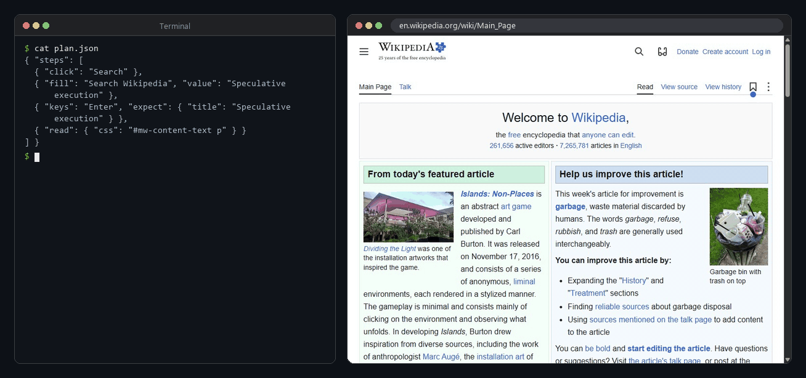
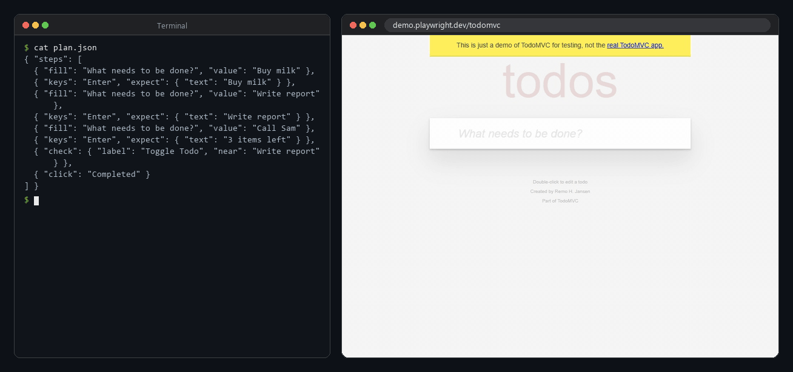
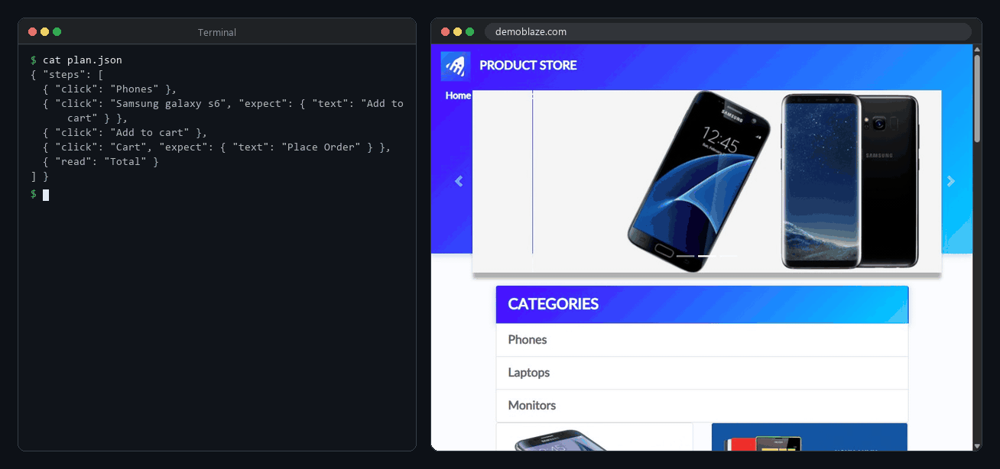
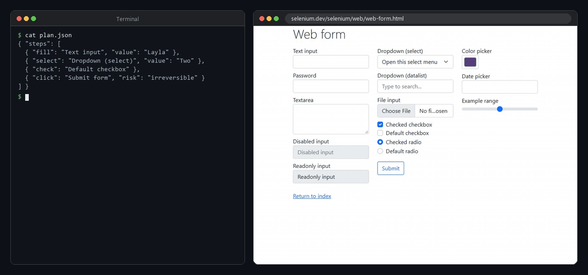
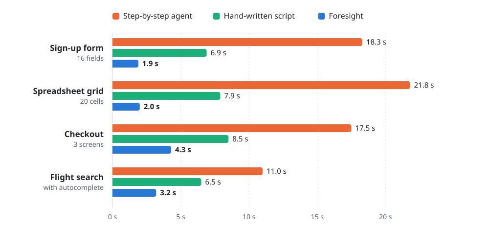

<p align="center">
  <picture>
    <source media="(prefers-color-scheme: dark)" srcset="assets/banner-dark.svg">
    
  </picture>
</p>

<p align="center">
  <a href="https://github.com/ammar-saleh/foresight/actions/workflows/test.yml"></a>
  <a href="LICENSE"></a>
</p>

<p align="center">
  <a href="#try-it">Try it</a> ·
  <a href="GUIDE.md">Guide</a> ·
  <a href="RESULTS.md">Test results</a>
</p>

AI assistants are slow on websites. They look at the page, think, click one thing, then look again, for every step.

Foresight lets the AI look once and write the whole plan. The engine runs the plan inside the page, checks each step, and stops when something is not what the plan expected.

<p align="center">
  
</p>
<p align="center"><sub>Recorded on demoqa.com. Same 13 steps, same simulated remote browser, no AI thinking time on either side.</sub></p>

## More demos

Each one is the real command-line tool on a real website. The terminal shows what it printed.

**Search Wikipedia and read the answer back**



**Add items in a to-do app, tick one, filter the list**



**Shop in a demo store and read the cart total**



## How it works

<p align="center">
  <picture>
    <source media="(prefers-color-scheme: dark)" srcset="assets/how-dark.svg">
    
  </picture>
</p>

A plan is a short list in plain words:

```json
{ "steps": [
  { "fill": "Customer name", "value": "Layla Haddad" },
  { "radio": "Pizza Size", "value": "Medium" },
  { "check": "Bacon" },
  { "click": "Submit order", "risk": "irreversible", "expect": { "text": "custname" } }
] }
```

The engine finds each control by the name a person would read on the page. If a step fails, the run stops there and tells the AI what it saw and where to pick up again.

## It stops instead of guessing



<p align="center"><sub>The plan says "Submit form". The button is called "Submit". Nothing is pressed.</sub></p>

- **Names have to match.** "Save" is not "Save changes".
- **It never answers a pop-up by itself.**
- **Clicks are real mouse presses.** One that would land on the wrong thing is cancelled.
- **It re-reads what it typed** before any step that cannot be undone.
- **Nothing is clicked twice.**

| Test | Result |
|---|---|
| 49 pages built to trick it into a harmful action | 0 harmful actions |
| 18 kinds of task on real websites | 36 of 36 correct |
| 156 pages written to break it | 154 pass, 2 are known limits |

## Speed

<p align="center">
  <picture>
    <source media="(prefers-color-scheme: dark)" srcset="assets/speed-dark.svg">
    
  </picture>
</p>
<p align="center"><sub>Local benchmark pages, engine only, through a remote browser (40 ms per round trip). Median of 5 runs.</sub></p>

With a real AI doing the thinking, on real websites:

| Task | Foresight | Step by step |
|---|---|---|
| Demo shop: find a product, add it to the cart, read the total | 14 s, 2 calls | 43 s, 10 calls |
| Practice form: 13 fields, a date picker, custom dropdowns | 20 s, 2 calls | 64 s |

More numbers are in [RESULTS.md](RESULTS.md).

## Try it

Needs Node 20+ and Chrome, Edge, Chromium or Brave.

```bash
git clone https://github.com/ammar-saleh/foresight.git
cd foresight
npm install

node cli/foresight.mjs open  demo https://httpbin.org/forms/post
node cli/foresight.mjs run   demo examples/pizza.json
node cli/foresight.mjs close demo
```

Add `--headed` to `open` to watch the browser. `npm test` runs the test suites.

To use it from an AI app, add the MCP server:

```json
{
  "mcpServers": {
    "foresight": { "command": "node", "args": ["/path/to/foresight/mcp/server.mjs"] }
  }
}
```

[GUIDE.md](GUIDE.md) is the manual for writing plans.

## Limits

- It is not a guarantee. A page built to deceive can still get through.
- It runs its own clean browser, so nothing behind a login has been tested.
- A page that rewords its labels on every load makes it ask the AI often, which costs the time it saved.
- Tested on Windows only. The desktop part (`desktop/`) is experimental.

## License

[MIT](LICENSE) © Ammar Saleh
