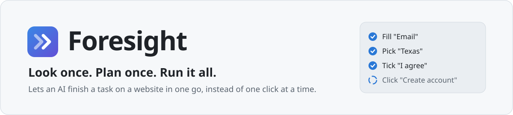
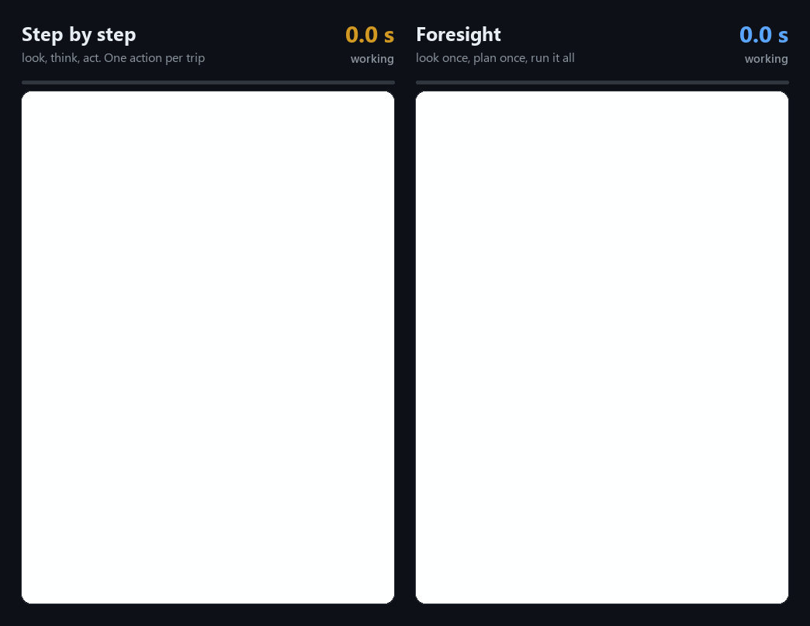
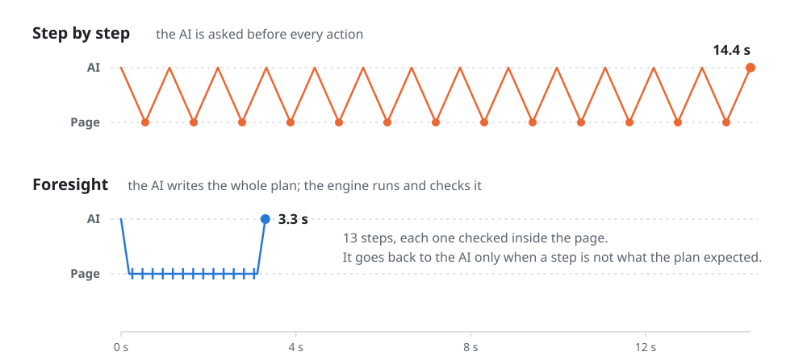

<p align="center">
  <picture>
    <source media="(prefers-color-scheme: dark)" srcset="assets/banner-dark.svg">
    
  </picture>
</p>

<p align="center">
  <a href="#try-it">Try it</a> ·
  <a href="GUIDE.md">Guide</a> ·
  <a href="RESULTS.md">Test results</a> ·
  <a href="#limits">Limits</a>
</p>

AI assistants are slow at using websites. They look at the page, think, click one thing, then look
again, and they repeat that for every single step. Filling in one form can take a minute.

Foresight lets the AI look at the page once and write the whole plan. The engine runs the plan inside
the page, checks every step as it goes, and stops the moment something is not what the plan expected.
The AI is asked again only when there is a real question.

<p align="center">
  
</p>
<p align="center"><sub>A real recording. Both sides fill the same 16-field form through the same simulated remote browser, and the page times itself.</sub></p>

## How it works

<p align="center">
  <picture>
    <source media="(prefers-color-scheme: dark)" srcset="assets/how-dark.svg">
    
  </picture>
</p>

A plan is a short list in plain words, written by any AI model:

```json
{ "steps": [
  { "fill": "Customer name", "value": "Layla Haddad" },
  { "radio": "Pizza Size", "value": "Medium" },
  { "check": "Bacon" },
  { "click": "Submit order", "risk": "irreversible", "expect": { "text": "custname" } }
] }
```

The engine finds each control by the name a person would read on the page, does the step, and checks
that it took. If a step fails or the page surprises it, the run stops there and tells the AI what it
saw, what it already did, and where to pick up again.

## How much faster

<p align="center">
  <picture>
    <source media="(prefers-color-scheme: dark)" srcset="assets/speed-dark.svg">
    
  </picture>
</p>
<p align="center"><sub>Time to finish each task through a remote browser (40 ms per round trip). Median of 5 runs, shorter is better.</sub></p>

| Task | Step-by-step agent | Hand-written script | Foresight |
|---|---|---|---|
| Sign-up form, 16 fields | 18.3 s | 6.9 s | **1.9 s** |
| Spreadsheet grid, 20 cells | 21.8 s | 7.9 s | **2.0 s** |
| Checkout, 3 screens | 17.5 s | 8.5 s | **4.3 s** |
| Flight search with autocomplete | 11.0 s | 6.5 s | **3.2 s** |

Those numbers are the engine alone. With a real AI doing the thinking, on real websites:

| Task | Foresight | Step by step |
|---|---|---|
| Demo shop: open a category, pick a product, add it to the cart, read the total | 14 s, 2 calls | 43 s, 10 calls |
| Practice form: 13 fields with a date picker and custom dropdowns, submit, read it back | 20 s, 2 calls | 64 s |

## Fast, and careful

Running a whole plan at once only helps if it never does the wrong thing quietly. So the engine
stops when it is unsure.

- **Names have to match.** "Save" is not "Save changes" and "Send" is not "Do not send". If the plan's
  name is not on the page, the run stops and lists the closest real names.
- **It never answers a pop-up by itself.** The AI decides what gets pressed in one.
- **Clicks are real mouse presses.** A press that would land on anything other than the intended
  control is cancelled before the page sees it.
- **It re-reads what it wrote** before any step that cannot be undone.
- **Nothing is clicked twice.** Every stop says whether the step reached the page.

| How it was tested | Result |
|---|---|
| 49 pages built to trick it into a harmful action, 2 runs each | 0 harmful actions |
| 18 kinds of task on real websites, end result checked independently | 36 of 36 correct |
| 156 pages written by reviewers whose job was to break it | 154 pass, 2 are documented limits |
| Fresh testers given only the guide, working on real sites | 20 of 20 correct in the latest round |

The full write-up, including what went wrong along the way, is in [RESULTS.md](RESULTS.md).

## Try it

You need Node 20 or newer and Chrome (Edge, Chromium and Brave also work).

```bash
git clone https://github.com/ammar-saleh/foresight.git
cd foresight
npm install

node cli/foresight.mjs open  demo https://httpbin.org/forms/post
node cli/foresight.mjs run   demo examples/pizza.json
node cli/foresight.mjs close demo
```

`open` prints what is on the page, the way the AI sees it. `run` fills in the order form, submits it
and prints what happened. Add `--headed` to `open` to watch the browser do it.

### Use it from an AI app

Foresight comes with an MCP server, so any AI app that supports MCP can use it as a tool:

```json
{
  "mcpServers": {
    "foresight": { "command": "node", "args": ["/path/to/foresight/mcp/server.mjs"] }
  }
}
```

[GUIDE.md](GUIDE.md) is the manual the AI reads. It covers the plan language, the reasons a run can
stop, and how to resume.

### Use it as a library

```js
import { Foresight } from './engine/foresight.js';

const fx = new Foresight({
  onConfirm: async ({ step }) => askUser(step),                     // before anything that cannot be undone
  onEscalate: async ({ step, failed }) => askModel(step, failed),   // only when the engine is stuck
});
fx.page = page;                        // a Playwright page
const report = await fx.run(plan);     // { ok, failedAt, failed, warnings, roundTrips, ms, ... }
```

## What's inside

| Path | What it is |
|---|---|
| `engine/` | The engine. One part runs inside the page, the other drives the plan |
| `cli/` | Command-line tool: `open`, `look`, `run`, `close` |
| `mcp/` | The same tools for AI apps |
| `GUIDE.md` | The manual for whoever writes plans, person or model |
| `bench/` | Speed benchmark, safety traps, real-site suite and the reviewers' pages |
| `site/` | Local test pages used by the benchmark and the traps |
| `desktop/` | An early version of the same idea for Windows apps |

Run the tests with `npm test`. They use local pages only and take a few minutes.

## Limits

- It is not a guarantee. It is built to stop when it is unsure, and every trick found so far is now a
  test, but a page built to deceive can still get through.
- It runs its own clean browser, so nothing behind a login has been tested.
- A page that rewords its labels on every load makes it ask the AI several times, which costs the
  time it would have saved.
- Everything here was tested on Windows. The web engine looks for Chrome on Mac as well, but that
  has not been run. The desktop part is Windows only and experimental.
- Apps drawn on a canvas need a screenshot and a click by position. Downloads are not handled.

## License

[MIT](LICENSE) © Ammar Saleh
